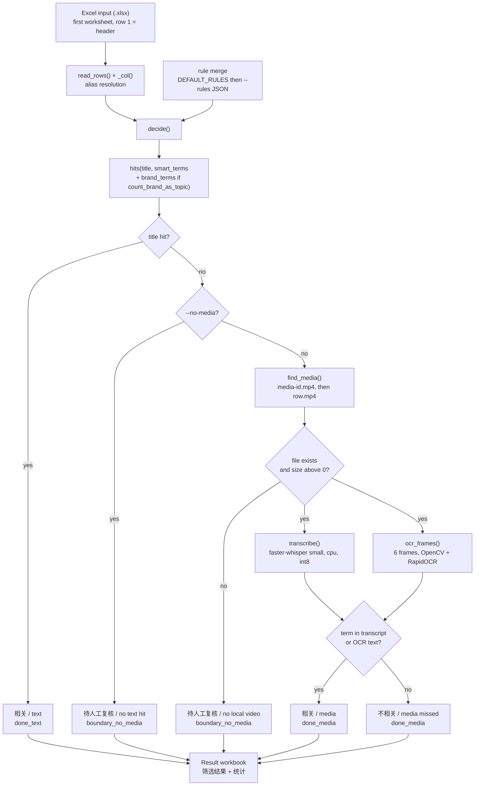
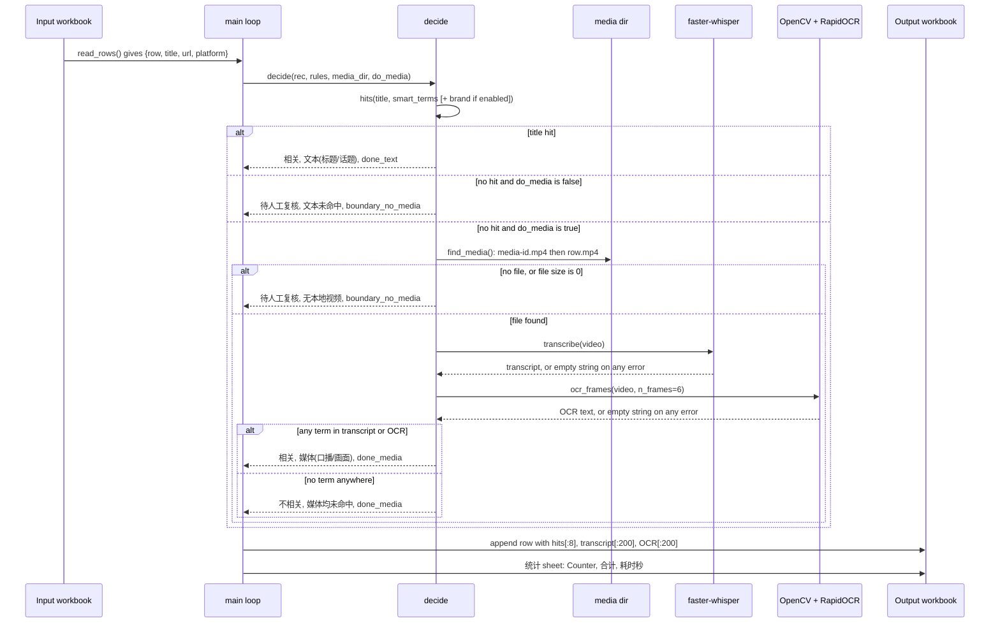
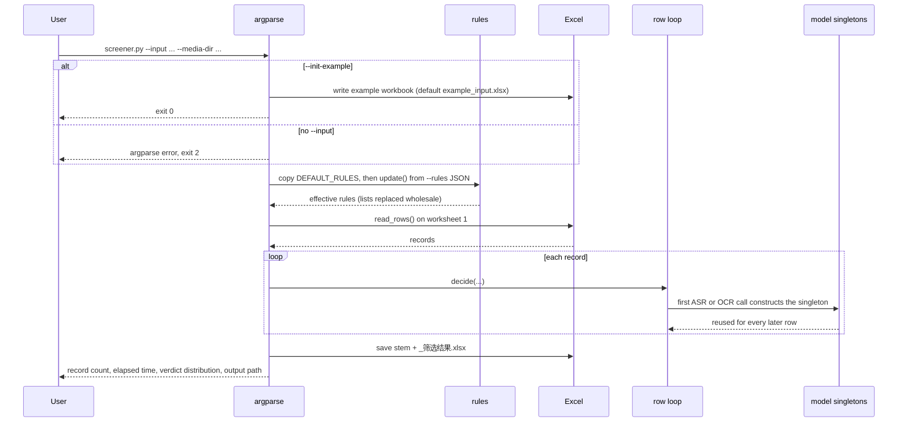
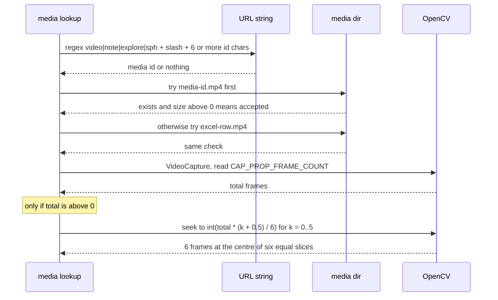
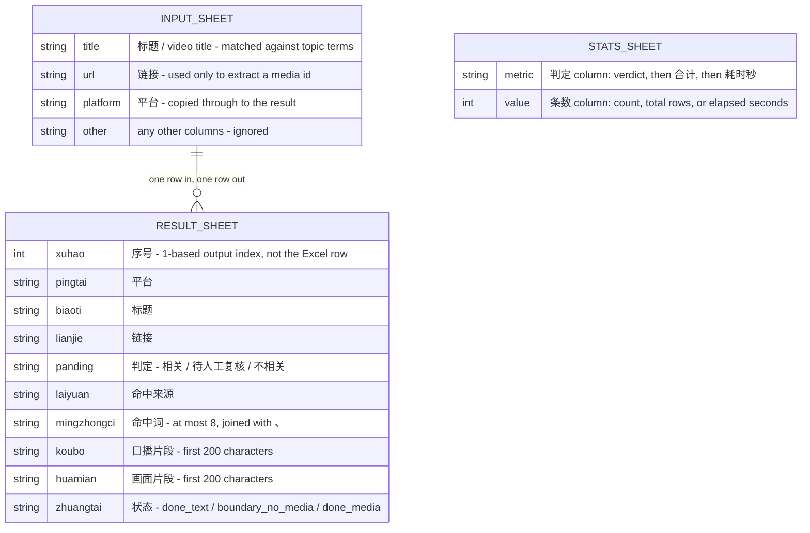
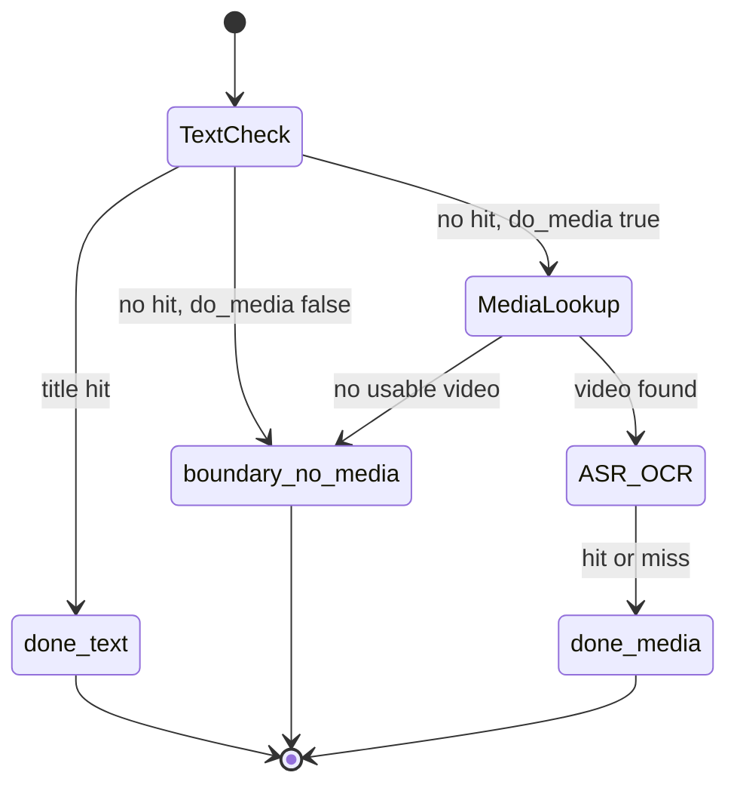

# sv-topic-screener — Multi-modal Short-Video Topic Screener

[English](README.md) | [简体中文](README.zh-CN.md)

A single-file, clean-room Python tool that decides whether each short video in an Excel
list is about a given topic. It collects three kinds of evidence in a fixed order — the
**title/topic text**, a **speech transcript** from faster-whisper, and **on-screen text**
read by OpenCV frame sampling plus RapidOCR — and writes the verdicts back to a new
workbook. The built-in demonstration topic is automotive driver-assist ("智驾" / ADAS), and
every term list is configurable. It never scrapes a platform and contains no third-party
proprietary code: you supply the videos yourself.

---

## Overview

The workflow it targets is a manual screening queue. A marketing or research team exports
a list of short videos from some platform's own dashboard into Excel, then a human opens
each one to decide "is this about driver-assist?" That is slow and inconsistent. This tool
replaces the first pass with deterministic keyword matching, and leaves only the genuinely
ambiguous rows for a human.

The input is an `.xlsx` file whose first worksheet has a header row containing a title
column, a link column and an optional platform column (many Chinese and English header
aliases are accepted, see [Input columns](#input-columns-and-aliases)). The videos
themselves must already be on local disk, named either by the media id extracted from the
URL or by the Excel row number. If a video is absent, the tool cannot look at its audio or
pixels and says so instead of guessing.

Every row ends in exactly one of four outcomes: **related via text**, **related via media**,
**needs manual review**, or **not related**. Rows that hit a term in the title are decided
without ever touching a video file, so a text-only run over a large sheet is fast.

### Clean-room and legal scope

- No platform scraping, no logins, no cookies, no private APIs. The repository contains no
  URL fetcher at all; `find_media` only looks for files that are already in a directory you
  pass in (`screener.py:72-83`).
- No third-party proprietary code or model weights are vendored. The dependencies in
  `requirements.txt` are public packages, and each one resolves its own model files at
  runtime.
- Responsibility for having the right to process a given video rests with whoever runs the
  tool. Nothing here bypasses a platform's terms of service because nothing here contacts a
  platform.

---

## Table of Contents

- [Overview](#overview)
- [Features](#features)
- [Architecture](#architecture)
- [Key flows](#key-flows)
- [Data model](#data-model)
- [Directory layout](#directory-layout)
- [Getting started](#getting-started)
- [Commands](#commands)
- [Configuration](#configuration)
- [CLI](#cli)
- [Troubleshooting](#troubleshooting)
- [Design decisions & limitations](#design-decisions--limitations)
- [FAQ](#faq)
- [License](#license)

---

## Features

| Area | Behaviour |
|---|---|
| Input | Excel `.xlsx`, first worksheet only, row 1 treated as the header (`screener.py:53-69`) |
| Column detection | Case-insensitive exact match against three alias lists (`screener.py:27-29`, `screener.py:45-50`) |
| Text check | Case-insensitive substring search of the title against the topic terms (`screener.py:140-142`) |
| Media check | faster-whisper transcript + 6-frame OpenCV/RapidOCR sample, merged (`screener.py:158-161`) |
| Media lookup | `<media-id>.mp4` from the URL, falling back to `<excel-row>.mp4` (`screener.py:72-83`) |
| Short-circuit | A title hit returns before any video is opened (`screener.py:150-152`) |
| Verdicts | `相关` / `待人工复核` / `不相关` with a machine-readable status column (`screener.py:145-164`) |
| Output | New workbook: one result sheet plus a `统计` sheet with counts and elapsed time (`screener.py:211-226`) |
| Example generator | `--init-example` writes a two-row demo workbook (`screener.py:167-175`) |
| Rules override | A JSON file shallow-merged over the built-in defaults (`screener.py:196-198`) |
| Text-only mode | `--no-media` skips ASR and OCR entirely (`screener.py:184`, `screener.py:153-154`) |

There is no concurrency, no caching to disk, no database, and no network code.

---

## Architecture

Everything except the two setup scripts is one module. The boxes below are functions in
`screener.py`; model objects are module-level singletons so they survive across rows.



*(source: `screener.py:140-164`, `screener.py:178-230`)*

| Layer | Path | Responsibility |
|---|---|---|
| CLI | `screener.py:178-230` | argparse, default output name, rules merge, per-row loop, workbook write, console summary |
| Input reader | `screener.py:53-69` | Load the first worksheet, resolve the title/url/platform columns, build `{row, title, url, platform}` records |
| Header matcher | `screener.py:45-50` | Strip + lowercase a header cell, return the first index matching an alias |
| Rules | `screener.py:32-42`, `rules.example.json` | Built-in term dictionaries and the overridable example |
| Matcher | `screener.py:140-142` | `hits(text, terms)` — lowercase substring containment |
| Decision | `screener.py:145-164` | The three-way precedence documented below |
| Media lookup | `screener.py:72-83` | URL regex, two filename candidates, non-empty-file check |
| ASR | `screener.py:86-99` | Lazy `WhisperModel` singleton, VAD on, beam size 1 |
| OCR | `screener.py:102-137` | Frame-count probe, uniform sampling, RapidOCR singleton, output-shape tolerance |
| Output writer | `screener.py:207-229` | Result rows, `统计` sheet, progress every 50 rows, console distribution |
| Setup | `setup.ps1`, `setup.bat` | Create `.venv` and `pip install -r requirements.txt` (Windows) |

---

## Key flows

### 1. One row, with a local video

This is the full path. The two media signals are independent: either one matching is
enough, and both are stored in the output even when the row is rejected.



*(source: `screener.py:145-164`, `screener.py:207`)*

### 2. Batch startup, rule merge and model caching

The models are built on first use and reused for the rest of the run. `--init-example`
returns before any input file is opened, and a missing `--input` is an argparse error
(exit code 2) rather than a silent no-op.



*(source: `screener.py:188-198`, `screener.py:86-96`, `screener.py:102-116`, `screener.py:227-229`)*

### 3. Media lookup and sampling detail

Worth knowing before naming your files, because a stale file silently wins.



The frame index formula `int(total * (k + 0.5) / n_frames)` samples slice centres rather
than the very first and last frames, which are often black or contain intros.
*(source: `screener.py:76-82`, `screener.py:112-122`)*

---

## Data model

The "database" is two Excel workbooks. Input columns are located by alias, so their order
does not matter and unread fields are ignored. Output columns are always written in the
same fixed order.



*(source: `screener.py:201-226`)*

### Input columns and aliases

Header matching is an **exact** comparison after `str().strip().lower()`, not a substring
or fuzzy match (`screener.py:45-50`). A header like `视频标题（必填）` therefore will not be
recognised as a title column. All three columns are optional; a missing one yields empty
strings for every row.

| Field | Accepted header names | Notes |
|---|---|---|
| Title | `标题`, `视频标题`, `短视频标题`, `作品标题`, `笔记标题`, `title` | The only field matched against topic terms |
| URL | `链接`, `视频链接`, `作品链接`, `笔记链接`, `url`, `url链接` | Only used to extract a media id; never opened |
| Platform | `平台`, `发布平台`, `媒体平台`, `platform` | Copied to the output, not matched |

### Output columns

| # | Column | Content | Source |
|---|---|---|---|
| 1 | `序号` | `1..N` in processing order | `screener.py:207` |
| 2 | `平台` | Input platform value | `screener.py:207` |
| 3 | `标题` | Input title value | `screener.py:207` |
| 4 | `链接` | Input URL value | `screener.py:207` |
| 5 | `判定` | `相关` / `待人工复核` / `不相关` | `screener.py:152-164` |
| 6 | `命中来源` | `文本(标题/话题)`, `文本未命中`, `无本地视频`, `媒体(口播/画面)`, `媒体均未命中` | `screener.py:152-164` |
| 7 | `命中词` | Matched terms joined with `、`, **first 8 only** | `screener.py:207` |
| 8 | `口播片段` | First 200 characters of the transcript, empty in text-only or no-media rows | `screener.py:163-164` |
| 9 | `画面片段` | First 200 characters of the OCR text, same caveat | `screener.py:163-164` |
| 10 | `状态` | `done_text`, `boundary_no_media`, `done_media` | `screener.py:152-164` |

The `统计` sheet holds two columns, `判定` and `条数`. It lists only verdicts that actually
occurred (a `Counter`), then a `合计` row with the row count, then a `耗时秒` row whose
number is the elapsed seconds rounded to one decimal (`screener.py:218-225`).

### Verdict precedence

This is the exact order inside `decide()`. The first matching branch returns and the rest
are never evaluated.

| Step | Condition | `判定` | `命中来源` | `命中词` | `状态` | Source |
|---|---|---|---|---|---|---|
| 1 | Title contains any topic term | `相关` | `文本(标题/话题)` | matched terms | `done_text` | `screener.py:150-152` |
| 2 | No title hit, `do_media` is false (`--no-media`) | `待人工复核` | `文本未命中` | empty | `boundary_no_media` | `screener.py:153-154` |
| 3 | No title hit, media enabled, no usable video file | `待人工复核` | `无本地视频` | empty | `boundary_no_media` | `screener.py:155-157` |
| 4 | Video found, a term appears in transcript **or** OCR text | `相关` | `媒体(口播/画面)` | deduplicated terms | `done_media` | `screener.py:160-163` |
| 5 | Video found, no term in either signal | `不相关` | `媒体均未命中` | empty | `done_media` | `screener.py:164` |

Two consequences worth stating plainly:

- Step 2 precedes step 3. Under `--no-media` a row never reaches `find_media`, so its
  `命中来源` is always `文本未命中` even when a matching video happens to exist.
- Step 1 precedes everything. A title hit costs no decode at all, so on a sheet where most
  titles are on-topic the media path runs for only the remainder.

### Per-row status lifecycle

The `状态` column takes exactly three values, and all of them are terminal — no row is
revisited or re-queued by the tool.



---

## Directory layout

```text
sv-topic-screener/
├─ screener.py          # the whole tool: reader, matcher, decision, ASR, OCR, writer
├─ rules.example.json   # overridable term dictionaries for the ADAS demo topic
├─ requirements.txt     # runtime dependencies (ASR, OCR, Excel)
├─ setup.ps1            # creates .venv and pip-installs requirements (Windows)
├─ setup.bat            # cmd wrapper that calls setup.ps1 with UTF-8 console
├─ README.md            # this file (English)
├─ README.zh-CN.md      # Simplified Chinese translation
└─ .gitignore           # venv, media, model cache, generated workbooks
```

`.gitignore` excludes `.venv/`, `__pycache__/`, `*.pyc`, `*.mp4`, `media/`, `hf_cache/`,
`*_筛选结果.xlsx` and `example_input.xlsx` — i.e. videos, model caches and generated
workbooks are never committed.

---

## Getting started

### Prerequisites

- **Python 3.11+**. `setup.ps1` prints a 3.11+ requirement when `python` is not on `PATH`
  (`setup.ps1:5`); the script does not enforce a version number.
- Network access on first setup: `pip` must download wheels, and the first ASR run
  downloads the Whisper model.
- **No system ffmpeg is required.** faster-whisper decodes through PyAV, which ships as the
  `av` wheel (`screener.py:90`).

### Install (Windows, scripted)

```powershell
git clone https://github.com/Ethan-upgrade/sv-topic-screener.git
cd sv-topic-screener
.\setup.bat
```

`setup.bat` sets `chcp 65001` and calls `setup.ps1`, which creates `.venv` and runs
`pip install --upgrade pip` followed by `pip install -r requirements.txt` (`setup.ps1:6-10`).

### Install (manual, any OS)

```bash
python -m venv .venv
# Windows
.venv\Scripts\python.exe -m pip install -r requirements.txt
# macOS / Linux
.venv/bin/python -m pip install -r requirements.txt
```

### Dependencies

| Package | Role |
|---|---|
| `faster-whisper` | ASR engine, `WhisperModel` (`screener.py:93-96`) |
| `ctranslate2` | Inference backend used by faster-whisper |
| `av` | PyAV demuxing/decoding, so no external ffmpeg binary is needed |
| `opencv-python-headless` | `cv2.VideoCapture`, frame count and seeking (`screener.py:110-122`) |
| `rapidocr` | OCR engine, `RapidOCR()` (`screener.py:114-116`) |
| `onnxruntime` | Inference backend used by RapidOCR |
| `openpyxl` | Reading and writing `.xlsx` (`screener.py:25`) |
| `numpy`, `pillow`, `tqdm` | Declared only; not imported by `screener.py` |

### First run

```powershell
.venv\Scripts\python.exe screener.py --init-example
.venv\Scripts\python.exe screener.py --input example_input.xlsx
.venv\Scripts\python.exe screener.py --input example_input.xlsx --media-dir .\media
```

The second command is text-only in effect (no `--media-dir`), so every row that misses on
text lands in `待人工复核`. The third reads `media\<media-id>.mp4` or `media\<row>.mp4`.

---

## Commands

| Command | Does |
|---|---|
| `setup.bat` / `powershell -File setup.ps1` | Create `.venv`, upgrade pip, install requirements |
| `python screener.py --init-example` | Write a 2-row demo workbook to `example_input.xlsx` and exit 0 |
| `python screener.py --init-example --input demo.xlsx` | Write the demo workbook to `demo.xlsx` instead |
| `python screener.py --input data.xlsx` | Text-only decision; no video files are opened |
| `python screener.py --input data.xlsx --no-media` | Same as above, made explicit even if a media dir is given |
| `python screener.py --input data.xlsx --media-dir videos` | Text first, then ASR + OCR for the remaining rows |
| `python screener.py --input data.xlsx --rules my-rules.json` | Use custom term dictionaries |
| `python screener.py --input data.xlsx --out result.xlsx` | Choose the output path |

There is no test suite, no linter configuration and no CI workflow in the repository.

---

## Configuration

### CLI flags

| Flag | Default | Behaviour |
|---|---|---|
| `--input` | empty | Input workbook. Required unless `--init-example`; missing it is an argparse error (exit 2) |
| `--out` | empty | Output path. When empty, `<input-stem>_筛选结果.xlsx` beside the input (`screener.py:195`) |
| `--media-dir` | empty | Directory holding the videos. Empty means every non-text row becomes `待人工复核` |
| `--rules` | empty | JSON rules file, shallow-merged over the defaults. A non-existent path is silently ignored |
| `--no-media` | off | Forces text-only mode; the media directory is not consulted |
| `--init-example` | off | Writes the demo workbook and returns before reading `--input` |

### Rules JSON

`rules` starts as a copy of `DEFAULT_RULES` and is then updated key by key, so unknown keys
pass through, omitted keys keep their defaults, and **lists are replaced entirely** rather
than appended (`screener.py:32-42`, `screener.py:196-198`).

| Key | Type | Default | Effect |
|---|---|---|---|
| `topic` | string | `"智驾"` | Printed in the banner only; not used in matching |
| `smart_terms` | string[] | 23 terms (`智驾`, `智能驾驶`, `辅助驾驶`, `自动驾驶`, `高阶智驾`, `领航辅助`, `领航`, `自动泊车`, `记忆泊车`, `代客泊车`, `泊车`, `激光雷达`, `世界模型`, `NOA`, `NGP`, `NCA`, `ACC`, `AEB`, `APA`, `AVP`, `LCC`, `LKA`, `TJA`) | Matched against title, transcript and OCR text |
| `brand_terms` | string[] | `["Momenta"]` | Matched against transcript and OCR **always**; against the title **only** when `count_brand_as_topic` is true |
| `exclude_terms` | string[] | `["纯话题标签", "无关样例词"]` | Parsed but never read anywhere in the code — it has no effect |
| `count_brand_as_topic` | bool | `false` | Adds `brand_terms` to the title check |

### Environment variables

| Variable | Default | Effect |
|---|---|---|
| `WHISPER_MODEL` | `small` | Model name passed to `WhisperModel`; read once, when the ASR singleton is first built (`screener.py:95`) |

### Hard-coded tuning values

| Setting | Value | Where |
|---|---|---|
| ASR device | `cpu` | `screener.py:95` |
| ASR compute type | `int8` | `screener.py:95` |
| VAD filter | on | `screener.py:96` |
| Beam size | `1` | `screener.py:96` |
| ASR language | not specified, so faster-whisper auto-detects | `screener.py:96` |
| OCR frames per video | `6` (`n_frames`) | `screener.py:105` |
| Transcript / OCR snippet kept in output | 200 characters each | `screener.py:163-164` |
| Matched terms shown per row | 8 | `screener.py:207` |
| Media filename extension | `.mp4` only | `screener.py:79` |
| Progress print interval | every 50 rows | `screener.py:208` |

---

## CLI

The tool is a single argparse program; there is no server and no HTTP API.

```text
python screener.py [--input PATH] [--out PATH] [--media-dir PATH]
                   [--rules PATH] [--no-media] [--init-example]
```

| Option | Type | Required | Notes |
|---|---|---|---|
| `--input` | path | yes, unless `--init-example` | `.xlsx`; only worksheet 1 is read |
| `--out` | path | no | Overwritten without prompting if it exists |
| `--media-dir` | path | no | Non-recursive: files must sit directly in this directory |
| `--rules` | path | no | Invalid JSON raises an uncaught exception |
| `--no-media` | flag | no | Short-circuits before `find_media` |
| `--init-example` | flag | no | Ignores `--out`, `--media-dir`, `--rules` |

Exit codes: `0` on a successful run or a generated example, `2` from argparse when
`--input` is missing.

### Expected media filenames

Given a URL containing a segment like `/video/1000000000000000001`, the id is
`1000000000000000001` and the first candidate is `1000000000000000001.mp4`. The second
candidate is `<excel row number>.mp4`, so the first data row (row 2 of the sheet) maps to
`2.mp4`. The id candidate is tried first; a zero-byte file is treated as absent
(`screener.py:76-82`).

---

## Troubleshooting

| Symptom | Cause | Fix |
|---|---|---|
| Every row is `待人工复核` with `无本地视频` | `--media-dir` points at the wrong folder, or filenames match neither candidate | Use `<media-id>.mp4` or `<row>.mp4` directly inside the given directory |
| A video exists but is ignored | Extension is not `.mp4`, or the file is zero bytes | Re-encode to `.mp4`; the size check is strict |
| The wrong file is analysed | A URL-derived `<media-id>.mp4` exists but is stale; it is preferred over `<row>.mp4` | Delete the stale file or name by row explicitly |
| All titles come out empty | Header is not on row 1, or the header text is not an exact alias | Move the header to row 1; rename `视频标题（必填）` to `视频标题` |
| A rules file seems to be ignored | The path does not exist — it is silently skipped | Verify the path; invalid JSON raises a traceback instead |
| Editing `smart_terms` had no effect | The rules list replaces the default list wholesale; a typo in a key creates a new unused key | Print `rules` or check spelling against the key table |
| ASR and OCR return nothing, rows become `不相关` | Every exception in `transcribe` and `ocr_frames` is swallowed and turned into an empty string | Test `faster_whisper` and `RapidOCR` standalone; check the install |
| OCR is empty but ASR works | `CAP_PROP_FRAME_COUNT` returned 0, so the sampling block never runs | Remux the file; some streamed containers lack a frame count |
| First run appears to hang | The Whisper model is being downloaded into the Hugging Face cache | Wait it out once; later runs reuse the cache |
| Output cannot be written | The target `.xlsx` is open in Excel | Close it and rerun |
| Console shows garbled Chinese on Windows | The shell code page is not UTF-8 | `chcp 65001`, as `setup.bat` does |
| `统计` sheet omits a verdict | The `Counter` only contains verdicts that occurred | Expected: zero-count verdicts are not listed |

---

## Design decisions & limitations

- **No scraping, by design.** The tool is decoupled from every platform. Getting the videos
  onto disk is the operator's job, which keeps the tool out of terms-of-service territory
  and makes reruns reproducible.
- **Only the title is text evidence.** The URL, the platform and any other columns are never
  matched against topic terms. A topic tag that lives only in a tag column or in the URL is
  invisible to the text check (`screener.py:146`).
- **Substring matching, not tokenisation.** `hits()` is lowercase containment, so short
  Latin abbreviations are risky: `ACC` matches `access` and `accessories`, `APA` matches
  `apart`. Precision depends on the term list being chosen carefully.
- **`exclude_terms` is dead configuration.** It is defined in `DEFAULT_RULES` and in
  `rules.example.json`, but no code path reads it. Setting it changes nothing.
- **Brand terms are asymmetric.** For the title they count only when
  `count_brand_as_topic` is true, but for transcript and OCR they are appended
  unconditionally (`screener.py:148-149`, `screener.py:160`). With the default
  `false`, a video whose only link to the topic is a spoken brand name will be `相关` via
  the media branch while the same brand in a title would not qualify.
- **Media failures are silent.** Any exception in decoding, ASR or OCR becomes `""`, and a
  row with two empty signals is reported as `不相关`, not `待人工复核`
  (`screener.py:98-99`, `screener.py:135-136`). A broken install can therefore look like a
  clean negative result. Cross-check `口播片段` / `画面片段` being empty on `done_media` rows.
- **Six uniform frames.** There is no scene detection and no OCR over time; burned-in text
  that appears only briefly can be missed entirely.
- **Small CPU model.** `small` on CPU with `int8` and `beam_size=1` is a speed choice at the
  cost of transcription accuracy, especially for accented or noisy audio. No language is
  pinned, so detection is per-clip.
- **Fully sequential.** Rows are processed one at a time; the ASR and OCR singletons make
  this cheap in memory but there is no parallelism.
- **The output is a fresh workbook.** Original columns and formulas are not carried over,
  and `序号` is a re-numbered `1..N`, so the source sheet row is not recorded in the output.
- **Header matching is strict.** Exact equality after trim and lowercase means decorated
  headers miss. See [Input columns](#input-columns-and-aliases).
- **No tests, no CI.** There is no automated coverage of `decide()`, which is the part most
  worth testing since it is pure and side-effect free apart from file lookups.

---

## FAQ

**Does it download the videos itself?** No. `find_media` only checks for local files
(`screener.py:72-83`). There is no HTTP client anywhere in the repository.

**Do I need ffmpeg installed?** No. faster-whisper decodes via PyAV (`av` wheel); OpenCV
decodes its own frames.

**Do I need a GPU?** No. The device is hard-coded to `cpu` and the compute type to `int8`
(`screener.py:95`).

**Can I use a bigger ASR model?** Yes — set `WHISPER_MODEL`, e.g. `medium` or
`large-v3`. It is read only when the singleton is built, so it applies from the next process
start, not mid-run.

**Can I screen a topic other than cars?** Yes. Replace `smart_terms` (and optionally
`brand_terms`) via `--rules`. `topic` is cosmetic and only appears in the console banner.

**What happens to a row with a video that cannot be decoded?** It is treated as two empty
signals and reported as `不相关`. Look for `done_media` rows with empty `口播片段` and
`画面片段` if you suspect this.

**Why is a brand-only clip `相关` when `count_brand_as_topic` is false?** Because the media
branch appends `brand_terms` regardless of that flag (`screener.py:160`). Set
`brand_terms: []` to disable brand matching everywhere.

**Can two videos have the same media id?** Not by accident: the candidate filename comes
from the URL, so identical URLs resolve to the same file. Use the `<row>.mp4` convention if
you need per-row files for duplicated links.

**Does it run on macOS or Linux?** `screener.py` is pure Python and portable. Only
`setup.bat` and `setup.ps1` are Windows-specific.

---

## License

No license file is included in this repository, and GitHub reports no license for it.
Treat the code as all rights reserved unless the author states otherwise.
