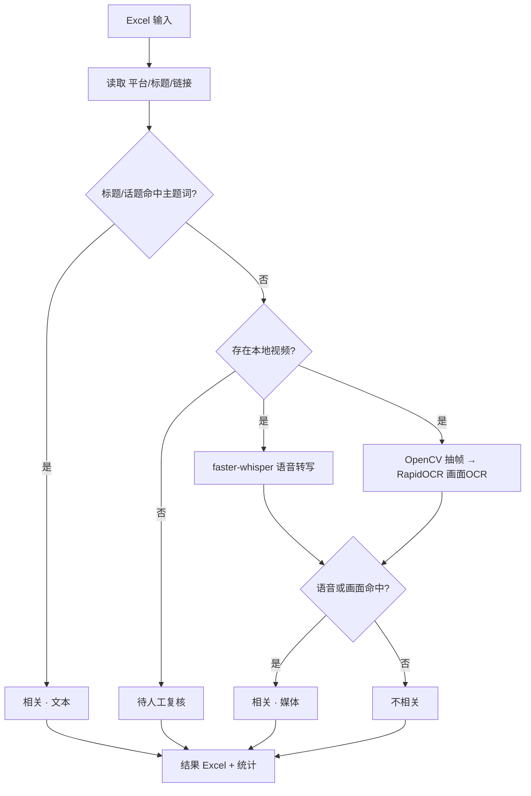

# 多模态短视频内容筛选框架（sv-topic-screener）

用**公开开源库**实现「标题 + 口播语音转写 + 画面文字 OCR」三路证据判定，判断短视频是否属于某主题（内置示例：汽车 **智驾/辅助驾驶**，词表可自定义）。**clean-room 通用实现**：不抓取任何平台、不含任何第三方专有代码；音视频素材由使用者自行合法提供。

## 主要功能
- 输入 Excel（`平台` / `视频链接` / `短视频标题`，列名支持常见别名）
- **文本判定**：标题/话题命中主题词 → 「相关」
- **媒体判定**（有本地视频时）：faster-whisper 语音转写 + OpenCV 抽帧 & RapidOCR 画面 OCR → 命中则「相关」
- 无视频且文本未命中 → 「待人工复核」
- 输出逐条结果 Excel（判定/来源/命中词/口播片段/画面片段/状态）+ 统计页

## 架构与流程


## 项目结构
```
sv-topic-screener/
├─ screener.py          # 主程序：文本+语音+画面 三路判定
├─ rules.example.json   # 主题词表（可自定义）
├─ requirements.txt
├─ setup.bat / setup.ps1
└─ README.md / README_EN.md
```

## 快速开始
```
git clone https://github.com/Ethan-upgrade/sv-topic-screener.git
cd sv-topic-screener
setup.bat                                        # 建 .venv 并装依赖
.venv\Scripts\python.exe screener.py --init-example
.venv\Scripts\python.exe screener.py --input 数据.xlsx --media-dir 视频目录
```

## 配置
编辑 `rules.example.json`：`topic` / `smart_terms` / `brand_terms` / `count_brand_as_topic`。

## 许可证
见仓库。