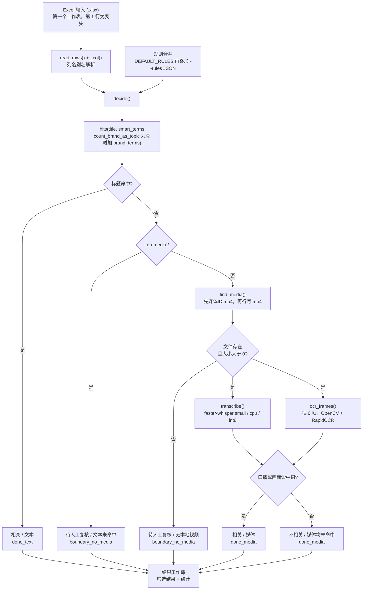
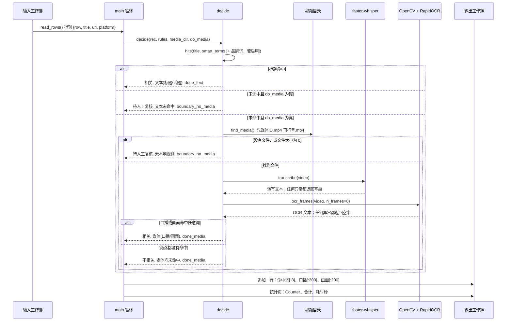
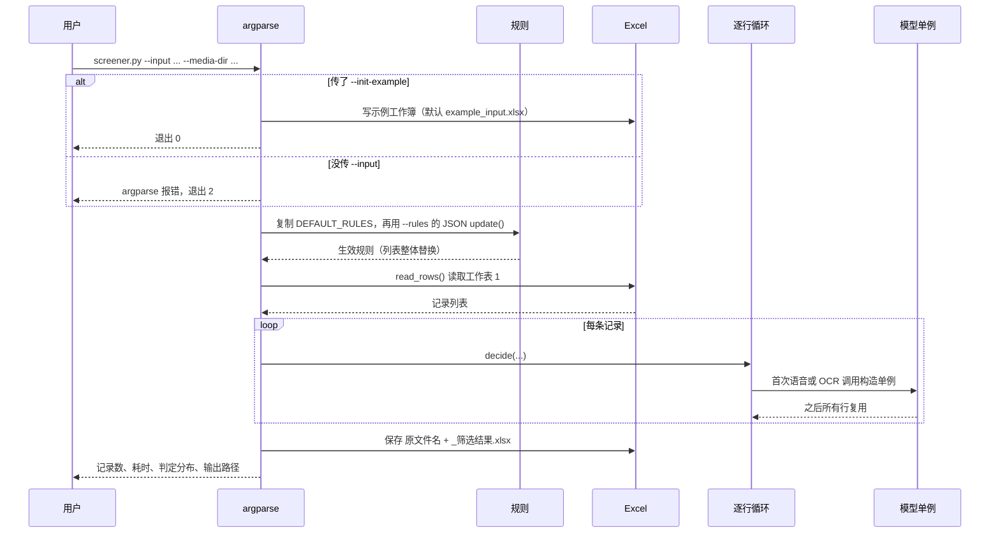
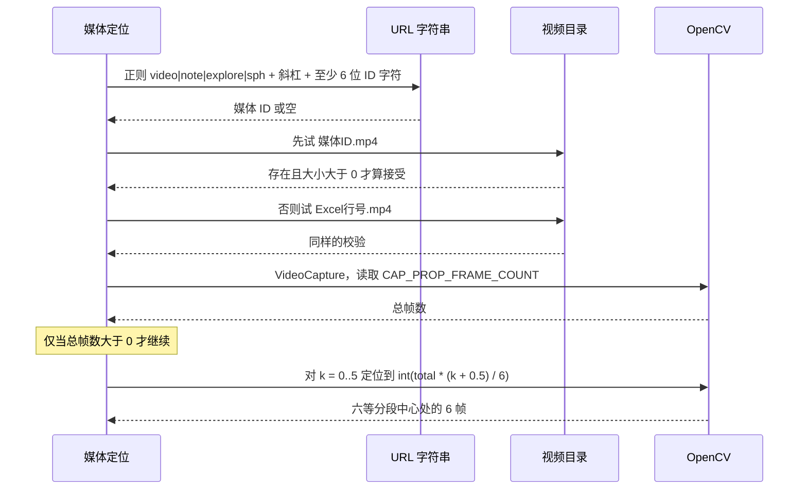
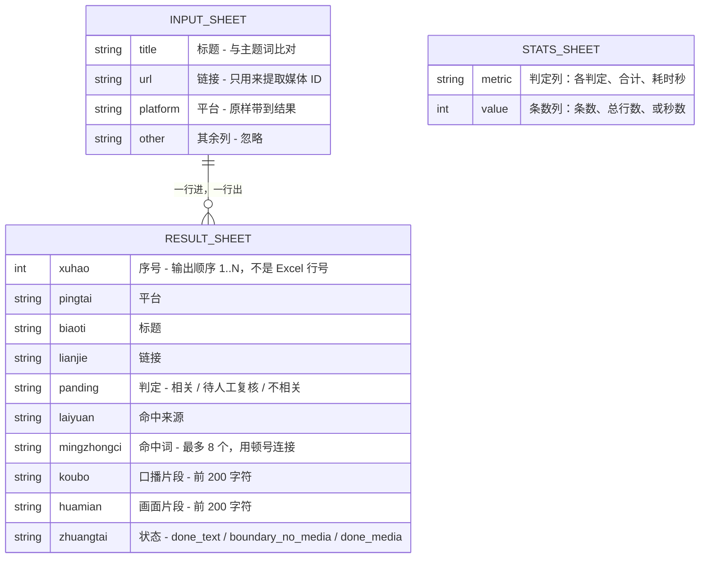
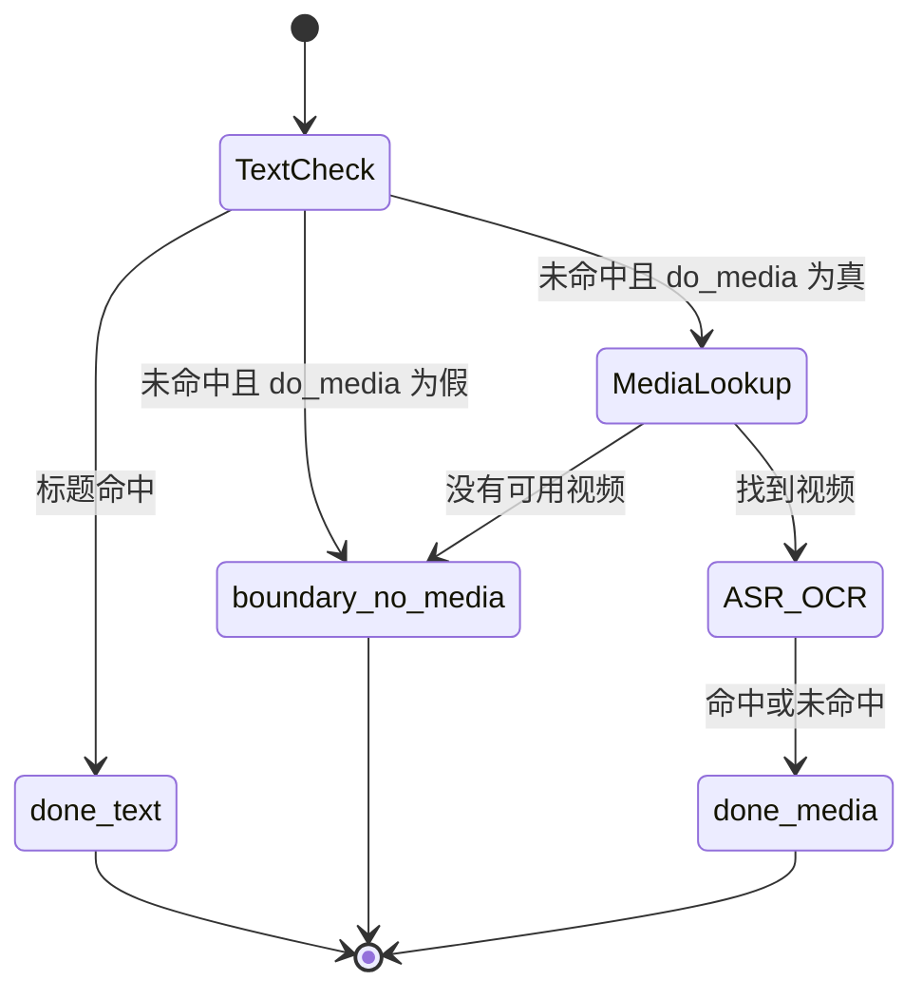

# sv-topic-screener — 多模态短视频主题筛选器

[English](README.md) | [简体中文](README.zh-CN.md)

一个单文件的 Python 工具，用公开开源库判断 Excel 清单中的每条短视频是否属于某个主题。
它按固定顺序收集三类证据——**标题/话题文本**、faster-whisper 转写的**口播语音**、以及
OpenCV 抽帧配 RapidOCR 读出的**画面文字**——再把判定结果写成新的工作簿。内置示例主题是
汽车智驾（ADAS），全部词表都可配置。工具不抓取任何平台，也不含任何第三方专有代码，
视频素材由使用者自行提供。

---

## 概述

它针对的是一条人工筛选队列。运营或研究同学先从平台自己的后台导出短视频清单到 Excel，
再由人工逐条打开判断"这条是不是讲智驾的"。这件事慢且标准不一。本工具用确定性的关键词
匹配替掉第一遍筛选，只把真正模糊的行留给人工。

输入是一个 `.xlsx`，第一个工作表的表头行里要有标题列、链接列，以及可选的平台列（支持
多种中英文列名别名，见[输入列与别名](#输入列与别名)）。视频本身必须已经在本地磁盘上，
文件名用 URL 中提取的媒体 ID，或直接用 Excel 行号。找不到视频时，工具不会去猜音频和
画面，而是明确标记为待复核。

每一行最终只会落入四种结果之一：**文本相关**、**媒体相关**、**待人工复核**、**不相关**。
标题命中词的行根本不会打开视频文件，因此在大表上做纯文本筛选很快。

### Clean-room 与合规边界

- 不抓取平台、不登录、不用 Cookie、不调私有接口。仓库里完全没有 URL 抓取代码，
  `find_media` 只在你传入的目录里找已存在的文件（`screener.py:72-83`）。
- 不内置任何第三方专有代码或模型权重。`requirements.txt` 里都是公开包，模型文件由各自
  的包在运行时解析。
- 是否有权处理某个视频，由运行工具的人负责。这里没有任何绕过平台条款的行为，
  因为这个工具根本不接触平台。

---

## 目录

- [概述](#概述)
- [功能](#功能)
- [架构](#架构)
- [关键流程](#关键流程)
- [数据模型](#数据模型)
- [目录结构](#目录结构)
- [快速开始](#快速开始)
- [命令](#命令)
- [配置](#配置)
- [命令行](#命令行)
- [排错](#排错)
- [设计取舍与局限](#设计取舍与局限)
- [常见问题](#常见问题)
- [许可证](#许可证)

---

## 功能

| 方面 | 行为 |
|---|---|
| 输入 | Excel `.xlsx`，只读第一个工作表，第 1 行视为表头（`screener.py:53-69`） |
| 列识别 | 对三组别名做忽略大小写的精确匹配（`screener.py:27-29`、`screener.py:45-50`） |
| 文本判定 | 标题对主题词做忽略大小写的子串匹配（`screener.py:140-142`） |
| 媒体判定 | faster-whisper 转写 + OpenCV 抽 6 帧 + RapidOCR，两路结果合并（`screener.py:158-161`） |
| 视频定位 | 先按 URL 提取的 `<媒体ID>.mp4`，再退回 `<Excel行号>.mp4`（`screener.py:72-83`） |
| 短路 | 标题命中即返回，不打开任何视频（`screener.py:150-152`） |
| 判定结果 | `相关` / `待人工复核` / `不相关`，另有机器可读的 `状态` 列（`screener.py:145-164`） |
| 输出 | 新工作簿：结果页 + `统计` 页（分布与耗时，`screener.py:211-226`） |
| 示例生成 | `--init-example` 写出两行示例工作簿（`screener.py:167-175`） |
| 规则覆盖 | JSON 文件浅合并覆盖内置默认值（`screener.py:196-198`） |
| 纯文本模式 | `--no-media` 完全跳过语音与画面（`screener.py:184`、`screener.py:153-154`） |

没有并发、没有磁盘缓存、没有数据库，也没有任何网络代码。

---

## 架构

除两个安装脚本外，全部逻辑都在一个模块里。下图中的方框是 `screener.py` 里的函数，
模型对象是模块级单例，因此能在多行之间复用。



*（来源：`screener.py:140-164`、`screener.py:178-230`）*

| 层 | 路径 | 职责 |
|---|---|---|
| 命令行 | `screener.py:178-230` | argparse、默认输出名、规则合并、逐行循环、写工作簿、控制台摘要 |
| 输入读取 | `screener.py:53-69` | 读第一个工作表、解析标题/链接/平台三列、组装 `{row, title, url, platform}` |
| 表头匹配 | `screener.py:45-50` | 对表头单元格去空白并转小写，返回首个命中的列下标 |
| 规则 | `screener.py:32-42`、`rules.example.json` | 内置词表与可覆盖的示例配置 |
| 匹配器 | `screener.py:140-142` | `hits(text, terms)`：转小写后的子串包含判断 |
| 判定 | `screener.py:145-164` | 下文记录的优先级链 |
| 媒体定位 | `screener.py:72-83` | URL 正则、两个候选文件名、非空文件校验 |
| 语音 | `screener.py:86-99` | 懒加载 `WhisperModel` 单例，开 VAD，beam size 1 |
| 画面 OCR | `screener.py:102-137` | 帧数探测、均匀抽帧、`RapidOCR` 单例、兼两种返回结构 |
| 输出写入 | `screener.py:207-229` | 结果行、`统计` 页、每 50 行打印进度、控制台分布 |
| 安装 | `setup.ps1`、`setup.bat` | 创建 `.venv` 并 `pip install -r requirements.txt`（Windows） |

---

## 关键流程

### 1. 单条记录（有本地视频）

这是完整路径。两路媒体证据彼此独立：任意一路命中即可，且无论最终是否判定为相关，
两段文本都会写进输出。



*（来源：`screener.py:145-164`、`screener.py:207`）*

### 2. 批量启动、规则合并与模型复用

模型在首次使用时构建，之后整个运行期复用。`--init-example` 在任何输入文件被打开之前
就返回；缺少 `--input` 是 argparse 报错（退出码 2），而不是静默空跑。



*（来源：`screener.py:188-198`、`screener.py:86-96`、`screener.py:102-116`、`screener.py:227-229`）*

### 3. 视频定位与抽帧细节

命名文件之前值得先看这一段，因为一个陈旧文件会静默胜出。



帧号公式 `int(total * (k + 0.5) / n_frames)` 取的是每一段的中心而不是首尾帧，因为首尾
往往是黑屏或片头。*（来源：`screener.py:76-82`、`screener.py:112-122`）*

---

## 数据模型

这里的"数据库"就是两个 Excel 工作簿。输入列按别名定位，因此列顺序无所谓，没被读取的列
直接忽略；输出列则始终按固定顺序写出。



*（来源：`screener.py:201-226`）*

### 输入列与别名

表头匹配是 `str().strip().lower()` 之后的**精确**比较，不是子串匹配，也不是模糊匹配
（`screener.py:45-50`）。所以 `视频标题（必填）` 这种表头不会被认成标题列。三列都是
可选的；缺哪列，对应字段在每一行都是空串。

| 字段 | 接受的表头名 | 说明 |
|---|---|---|
| 标题 | `标题`、`视频标题`、`短视频标题`、`作品标题`、`笔记标题`、`title` | 唯一参与主题词比对的字段 |
| 链接 | `链接`、`视频链接`、`作品链接`、`笔记链接`、`url`、`url链接` | 只用于提取媒体 ID，从不被打开 |
| 平台 | `平台`、`发布平台`、`媒体平台`、`platform` | 原样写入输出，不参与匹配 |

### 输出列

| # | 列 | 内容 | 来源 |
|---|---|---|---|
| 1 | `序号` | 处理顺序 `1..N` | `screener.py:207` |
| 2 | `平台` | 输入的平台值 | `screener.py:207` |
| 3 | `标题` | 输入的标题值 | `screener.py:207` |
| 4 | `链接` | 输入的链接值 | `screener.py:207` |
| 5 | `判定` | `相关` / `待人工复核` / `不相关` | `screener.py:152-164` |
| 6 | `命中来源` | `文本(标题/话题)`、`文本未命中`、`无本地视频`、`媒体(口播/画面)`、`媒体均未命中` | `screener.py:152-164` |
| 7 | `命中词` | 命中词用 `、` 连接，**只取前 8 个** | `screener.py:207` |
| 8 | `口播片段` | 转写文本前 200 字符；纯文本模式或无视频时为空 | `screener.py:163-164` |
| 9 | `画面片段` | OCR 文本前 200 字符，同上 | `screener.py:163-164` |
| 10 | `状态` | `done_text`、`boundary_no_media`、`done_media` | `screener.py:152-164` |

`统计` 页只有两列：`判定` 和 `条数`。它用 `Counter` 只列出实际出现过的判定，接着是
`合计` 行（总行数），最后是 `耗时秒` 行（耗时保留一位小数，`screener.py:218-225`）。

### 判定优先级

下面是 `decide()` 内部的真实顺序。先命中的分支直接返回，后面的分支不再求值。

| 步骤 | 条件 | `判定` | `命中来源` | `命中词` | `状态` | 来源 |
|---|---|---|---|---|---|---|
| 1 | 标题包含任意主题词 | `相关` | `文本(标题/话题)` | 命中的词 | `done_text` | `screener.py:150-152` |
| 2 | 标题未命中，且 `do_media` 为假（`--no-media`） | `待人工复核` | `文本未命中` | 空 | `boundary_no_media` | `screener.py:153-154` |
| 3 | 标题未命中，启用了媒体，但没有可用视频文件 | `待人工复核` | `无本地视频` | 空 | `boundary_no_media` | `screener.py:155-157` |
| 4 | 找到视频，口播**或**画面文本出现任意词 | `相关` | `媒体(口播/画面)` | 去重后的词 | `done_media` | `screener.py:160-163` |
| 5 | 找到视频，两路信号都没命中 | `不相关` | `媒体均未命中` | 空 | `done_media` | `screener.py:164` |

两个值得说清的后果：

- 步骤 2 在步骤 3 之前。开了 `--no-media` 时，行根本不会走到 `find_media`，所以
  `命中来源` 永远是 `文本未命中`，即便磁盘上恰好有对应视频。
- 步骤 1 在最前。标题命中完全不需要解码，所以标题大多相关的表里，媒体路径只跑剩下的
  那一部分。

### 单行状态流转

`状态` 列只有三个取值，且都是终态——工具不会回头重跑或重新排队任何一行。



---

## 目录结构

```text
sv-topic-screener/
├─ screener.py          # 全部逻辑：读取、匹配、判定、语音、OCR、写出
├─ rules.example.json   # 可覆盖的词表（智驾示例主题）
├─ requirements.txt     # 运行时依赖（语音、OCR、Excel）
├─ setup.ps1            # 创建 .venv 并安装依赖（Windows）
├─ setup.bat            # cmd 包装，切 UTF-8 代码页后调用 setup.ps1
├─ README.md            # 英文版
├─ README.zh-CN.md      # 本文件（简体中文）
└─ .gitignore           # 虚拟环境、视频、模型缓存、生成的工作簿
```

`.gitignore` 排除了 `.venv/`、`__pycache__/`、`*.pyc`、`*.mp4`、`media/`、`hf_cache/`、
`*_筛选结果.xlsx` 和 `example_input.xlsx`——也就是视频、模型缓存和生成的工作簿都不会
进版本库。

---

## 快速开始

### 环境要求

- **Python 3.11+**。`setup.ps1` 在 `python` 不在 `PATH` 上时会提示需要 3.11+
  （`setup.ps1:5`），脚本本身并不校验版本号。
- 首次安装需要联网：`pip` 要下载 wheel；首次跑语音时还要下载 Whisper 模型。
- **不需要系统 ffmpeg**。faster-whisper 通过 PyAV 解码，`av` 以 wheel 形式安装
  （`screener.py:90`）。

### 安装（Windows，脚本方式）

```powershell
git clone https://github.com/Ethan-upgrade/sv-topic-screener.git
cd sv-topic-screener
.\setup.bat
```

`setup.bat` 先 `chcp 65001` 再调用 `setup.ps1`；后者创建 `.venv`，执行
`pip install --upgrade pip`，然后 `pip install -r requirements.txt`（`setup.ps1:6-10`）。

### 安装（手动，任意系统）

```bash
python -m venv .venv
# Windows
.venv\Scripts\python.exe -m pip install -r requirements.txt
# macOS / Linux
.venv/bin/python -m pip install -r requirements.txt
```

### 依赖说明

| 包 | 作用 |
|---|---|
| `faster-whisper` | 语音引擎，`WhisperModel`（`screener.py:93-96`） |
| `ctranslate2` | faster-whisper 的推理后端 |
| `av` | PyAV 解封装/解码，因此不需要外部 ffmpeg |
| `opencv-python-headless` | `cv2.VideoCapture`、帧数与定位（`screener.py:110-122`） |
| `rapidocr` | OCR 引擎，`RapidOCR()`（`screener.py:114-116`） |
| `onnxruntime` | RapidOCR 的推理后端 |
| `openpyxl` | 读写 `.xlsx`（`screener.py:25`） |
| `numpy`、`pillow`、`tqdm` | 仅声明，`screener.py` 并未直接导入 |

### 首次运行

```powershell
.venv\Scripts\python.exe screener.py --init-example
.venv\Scripts\python.exe screener.py --input example_input.xlsx
.venv\Scripts\python.exe screener.py --input example_input.xlsx --media-dir .\media
```

第二条实际上只做文本判定（没给 `--media-dir`），所以没命中的行都会落到 `待人工复核`。
第三条会去找 `media\<媒体ID>.mp4` 或 `media\<行号>.mp4`。

---

## 命令

| 命令 | 作用 |
|---|---|
| `setup.bat` / `powershell -File setup.ps1` | 创建 `.venv`、升级 pip、安装依赖 |
| `python screener.py --init-example` | 在 `example_input.xlsx` 写两行示例并退出 0 |
| `python screener.py --init-example --input demo.xlsx` | 示例改写到 `demo.xlsx` |
| `python screener.py --input data.xlsx` | 纯文本判定，不打开任何视频 |
| `python screener.py --input data.xlsx --no-media` | 与上一条相同，即便给了视频目录也强制纯文本 |
| `python screener.py --input data.xlsx --media-dir videos` | 先文本，剩余行再做语音 + 画面 |
| `python screener.py --input data.xlsx --rules my-rules.json` | 使用自定义词表 |
| `python screener.py --input data.xlsx --out result.xlsx` | 指定输出路径 |

仓库里没有测试套件、没有 lint 配置，也没有 CI 工作流。

---

## 配置

### 命令行参数

| 参数 | 默认值 | 行为 |
|---|---|---|
| `--input` | 空 | 输入工作簿。除 `--init-example` 外必填，缺失即 argparse 报错（退出 2） |
| `--out` | 空 | 输出路径。为空时在输入文件旁生成 `<原文件名>_筛选结果.xlsx`（`screener.py:195`） |
| `--media-dir` | 空 | 存放视频的目录。为空则所有未命中文本的行都变成 `待人工复核` |
| `--rules` | 空 | JSON 规则文件，浅合并覆盖默认值。路径不存在会被静默忽略 |
| `--no-media` | 关 | 强制纯文本模式，不查视频目录 |
| `--init-example` | 关 | 写示例工作簿，在读取 `--input` 之前就返回 |

### 规则 JSON

`rules` 先复制 `DEFAULT_RULES`，再逐键 update。因此未知键会原样保留，省略的键保留默认值，
而**列表是整体替换**，不是追加（`screener.py:32-42`、`screener.py:196-198`）。

| 键 | 类型 | 默认值 | 作用 |
|---|---|---|---|
| `topic` | 字符串 | `"智驾"` | 只出现在控制台横幅里，不参与匹配 |
| `smart_terms` | 字符串数组 | 23 个词（`智驾`、`智能驾驶`、`辅助驾驶`、`自动驾驶`、`高阶智驾`、`领航辅助`、`领航`、`自动泊车`、`记忆泊车`、`代客泊车`、`泊车`、`激光雷达`、`世界模型`、`NOA`、`NGP`、`NCA`、`ACC`、`AEB`、`APA`、`AVP`、`LCC`、`LKA`、`TJA`） | 同时用于标题、口播和画面 |
| `brand_terms` | 字符串数组 | `["Momenta"]` | 口播与画面**始终**参与；标题**只有** `count_brand_as_topic` 为真时才参与 |
| `exclude_terms` | 字符串数组 | `["纯话题标签", "无关样例词"]` | 会被解析，但代码里从不读取——设置了也没有任何效果 |
| `count_brand_as_topic` | 布尔 | `false` | 把 `brand_terms` 加进标题检查 |

### 环境变量

| 变量 | 默认值 | 作用 |
|---|---|---|
| `WHISPER_MODEL` | `small` | 传给 `WhisperModel` 的模型名；只在 ASR 单例首次构建时读取（`screener.py:95`） |

### 写死的调参值

| 设置 | 值 | 位置 |
|---|---|---|
| 语音设备 | `cpu` | `screener.py:95` |
| 计算类型 | `int8` | `screener.py:95` |
| VAD 过滤 | 开启 | `screener.py:96` |
| beam size | `1` | `screener.py:96` |
| 语音语言 | 未指定，由 faster-whisper 自动检测 | `screener.py:96` |
| 每条视频 OCR 帧数 | `6`（`n_frames`） | `screener.py:105` |
| 写入输出的文本片段长度 | 各 200 字符 | `screener.py:163-164` |
| 每行展示的命中词 | 8 个 | `screener.py:207` |
| 视频文件扩展名 | 仅 `.mp4` | `screener.py:79` |
| 进度打印间隔 | 每 50 行 | `screener.py:208` |

---

## 命令行

这是一个单文件 argparse 程序，没有服务端，也没有 HTTP 接口。

```text
python screener.py [--input PATH] [--out PATH] [--media-dir PATH]
                   [--rules PATH] [--no-media] [--init-example]
```

| 选项 | 类型 | 必填 | 说明 |
|---|---|---|---|
| `--input` | 路径 | 是（`--init-example` 除外） | `.xlsx`；只读第一个工作表 |
| `--out` | 路径 | 否 | 已存在时直接覆盖，不提示 |
| `--media-dir` | 路径 | 否 | 不递归：文件必须直接放在这个目录里 |
| `--rules` | 路径 | 否 | JSON 非法会抛出未捕获异常 |
| `--no-media` | 开关 | 否 | 在 `find_media` 之前短路 |
| `--init-example` | 开关 | 否 | 忽略 `--out`、`--media-dir`、`--rules` |

退出码：正常运行或生成示例返回 `0`；缺少 `--input` 时由 argparse 返回 `2`。

### 视频文件命名约定

如果 URL 里有类似 `/video/1000000000000000001` 的片段，媒体 ID 就是
`1000000000000000001`，第一个候选文件是 `1000000000000000001.mp4`。第二个候选是
`<Excel行号>.mp4`，所以第一条数据行（表里第 2 行）对应 `2.mp4`。先试 ID 候选；
零字节文件视为不存在（`screener.py:76-82`）。

---

## 排错

| 现象 | 原因 | 处理 |
|---|---|---|
| 所有行都是 `待人工复核` + `无本地视频` | `--media-dir` 指错了目录，或文件名两个候选都不匹配 | 把 `<媒体ID>.mp4` 或 `<行号>.mp4` 直接放进该目录 |
| 明明有视频却被忽略 | 扩展名不是 `.mp4`，或文件是 0 字节 | 转成 `.mp4`；大小检查是严格的 |
| 分析的不是想要的那个文件 | URL 提取出的 `<媒体ID>.mp4` 存在但已经过期，它优先于 `<行号>.mp4` | 删掉过期文件，或统一用行号命名 |
| 所有标题都是空的 | 表头不在第 1 行，或表头文字不是精确别名 | 把表头移到第 1 行；把 `视频标题（必填）` 改成 `视频标题` |
| 规则文件好像没生效 | 路径不存在时被静默跳过 | 确认路径；JSON 非法则会直接抛异常 |
| 改了 `smart_terms` 没变化 | 列表是整体替换；键名写错会变成一个没用的新键 | 打印 `rules` 或对照键名表检查拼写 |
| 语音和 OCR 都为空，行变成 `不相关` | `transcribe` 和 `ocr_frames` 里所有异常都被吞掉并转成空串 | 单独测试 `faster_whisper` 和 `RapidOCR`，检查安装 |
| OCR 为空但语音正常 | `CAP_PROP_FRAME_COUNT` 返回 0，抽帧代码块根本没执行 | 重新封装文件；部分流式容器不提供帧数 |
| 首次运行像是卡住了 | Whisper 模型正在下载到 Hugging Face 缓存 | 等一次即可，之后复用缓存 |
| 输出写不进去 | 目标 `.xlsx` 正在 Excel 里打开 | 关掉再跑 |
| Windows 控制台中文乱码 | 终端代码页不是 UTF-8 | 执行 `chcp 65001`，`setup.bat` 就是这么做的 |
| `统计` 页少了某个判定 | `Counter` 只记录实际出现过的判定 | 属预期：数量为 0 的判定不会列出 |

---

## 设计取舍与局限

- **有意不抓取。** 工具与所有平台解耦，把视频落到磁盘是使用者的工作。这让它远离平台
  条款问题，也让复跑可复现。
- **文本证据只有标题。** 链接、平台以及其它任何列都不参与主题词比对。只存在于标签列或
  URL 里的话题标签，对文本判定完全不可见（`screener.py:146`）。
- **子串匹配，不做分词。** `hits()` 是小写包含判断，短的拉丁缩写很容易误伤：`ACC` 会
  命中 `access` 和 `accessories`，`APA` 会命中 `apart`。精度取决于词表挑得够不够细。
- **`exclude_terms` 是死配置。** 它在 `DEFAULT_RULES` 和 `rules.example.json` 里都有定义，
  但没有任何代码路径读取它。设置它不会改变任何结果。
- **品牌词两侧不对称。** 标题里要 `count_brand_as_topic` 为真才算，口播和画面里则是
  无条件追加（`screener.py:148-149`、`screener.py:160`）。在默认的 `false` 下，一条仅
  因口播提到品牌而与主题有关的视频会被媒体分支判为 `相关`，而同样的品牌出现在标题里
  反而不算。
- **媒体失败是静默的。** 解码、语音、OCR 的任何异常都会变成 `""`，两路都为空的行走
  `不相关` 而不是 `待人工复核`（`screener.py:98-99`、`screener.py:135-136`）。也就是说，
  装坏的依赖看起来会像"干净的不相关结果"。如果怀疑，就去查 `done_media` 行里
  `口播片段` / `画面片段` 是否为空。
- **只有 6 帧且均匀分布。** 没有镜头检测，也不做跨时间 OCR；只闪一下的画面文字可能被
  完全漏掉。
- **CPU 小模型。** `small` + `int8` + `beam_size=1` 是用精度换速度的选择，带口音或嘈杂
  音频上尤其明显。没有固定语言，逐条自动检测。
- **完全串行。** 逐行处理；语音与 OCR 单例让内存开销可控，但没有并行。
- **输出是全新工作簿。** 原始列和公式不会保留，`序号` 是重排的 `1..N`，所以源表行号
  不会出现在结果里。
- **表头匹配很严格。** 去空白转小写后的精确相等，带装饰的表头会漏。见
  [输入列与别名](#输入列与别名)。
- **没有测试、没有 CI。** `decide()` 是最值得测的部分（除了文件查找外基本是纯函数），
  但目前没有任何自动化覆盖。

---

## 常见问题

**它会自己下载视频吗？** 不会。`find_media` 只检查本地文件（`screener.py:72-83`），仓库里
没有任何 HTTP 客户端。

**需要安装 ffmpeg 吗？** 不需要。faster-whisper 通过 PyAV（`av` wheel）解码，OpenCV 自己
解码抽帧。

**需要 GPU 吗？** 不需要。设备写死为 `cpu`，计算类型写死为 `int8`（`screener.py:95`）。

**能换更大的语音模型吗？** 可以，设置 `WHISPER_MODEL`，例如 `medium` 或 `large-v3`。
它只在单例构建时读取，所以下次启动进程才生效，不能中途切换。

**除了汽车，能筛别的主题吗？** 能。用 `--rules` 替换 `smart_terms`（以及可选的
`brand_terms`）。`topic` 只用于控制台横幅，不影响匹配。

**视频解不出来时会怎样？** 会被当作两路空信号，判为 `不相关`。如果怀疑这种情况，去看
`done_media` 行里 `口播片段` 和 `画面片段` 是否都为空。

**为什么 `count_brand_as_topic` 为假，只提品牌的视频还是 `相关`？** 因为媒体分支不看
这个开关，无条件追加 `brand_terms`（`screener.py:160`）。想在所有环节关掉品牌匹配，
把它设成 `brand_terms: []`。

**两条视频会用到同一个媒体 ID 吗？** 不会凭空发生：候选文件名来自 URL，相同 URL 自然
指向同一个文件。如果重复链接需要各自独立的视频，就用 `<行号>.mp4` 的约定。

**能在 macOS 或 Linux 上跑吗？** `screener.py` 是纯 Python，可移植。只有 `setup.bat` 和
`setup.ps1` 是 Windows 专用。

---

## 许可证

仓库中没有许可证文件，GitHub 也显示该项目没有 license。除非作者另有说明，否则视为
保留所有权利。
