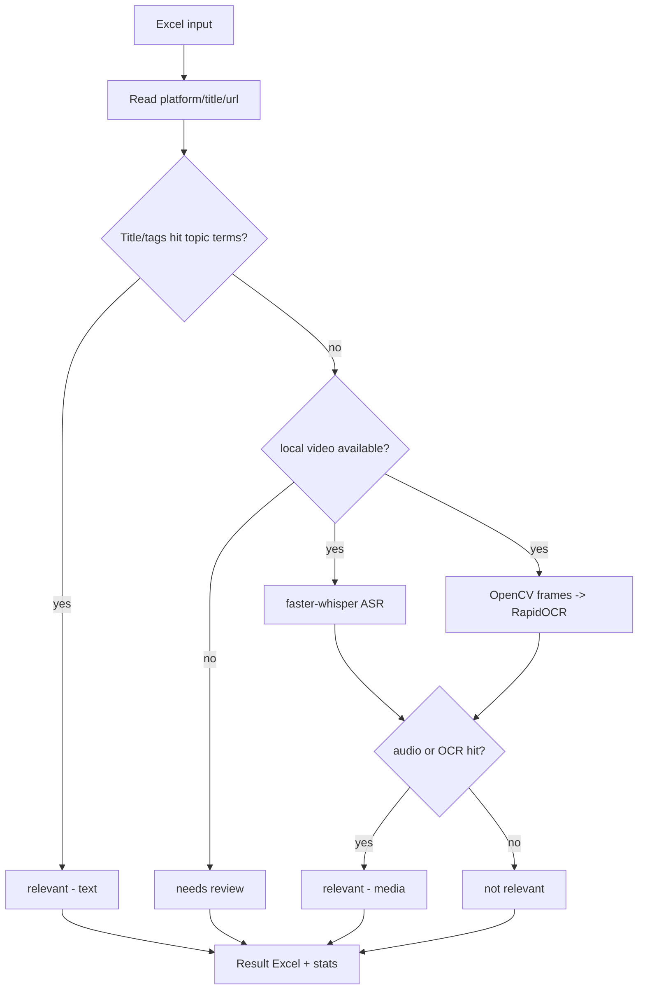

# sv-topic-screener — Multi-modal Short-Video Topic Screening

A **clean-room**, open-source-library implementation of a three-signal decision pipeline — **title + speech transcript + on-screen OCR** — to decide whether a short video belongs to a topic (built-in demo: automotive **ADAS / intelligent-driving**, fully configurable). It does **not** scrape any platform and contains **no third-party proprietary code**; you provide the audio/video material lawfully.

## Key Features
- Input: Excel (`platform` / `video url` / `title`, common header aliases supported).
- **Text decision**: title/tags hit topic terms -> `relevant`.
- **Media decision** (when a local video is available): faster-whisper ASR + OpenCV frame sampling & RapidOCR -> `relevant` if any hit.
- No video and no text hit -> `needs review`.
- Output: per-row result Excel (decision/source/hits/transcript/ocr/status) + a stats sheet.

## Architecture & Workflow


## Project Structure
```
sv-topic-screener/
├─ screener.py          # main: text + speech + OCR decision
├─ rules.example.json   # configurable topic terms
├─ requirements.txt
├─ setup.bat / setup.ps1
└─ README.md / README_EN.md
```

## Getting Started
```
git clone https://github.com/Ethan-upgrade/sv-topic-screener.git
cd sv-topic-screener
setup.bat
.venv\Scripts\python.exe screener.py --init-example
.venv\Scripts\python.exe screener.py --input data.xlsx --media-dir videos
```

## Configuration
Edit `rules.example.json`: `topic` / `smart_terms` / `brand_terms` / `count_brand_as_topic`.

## License
See the repository.